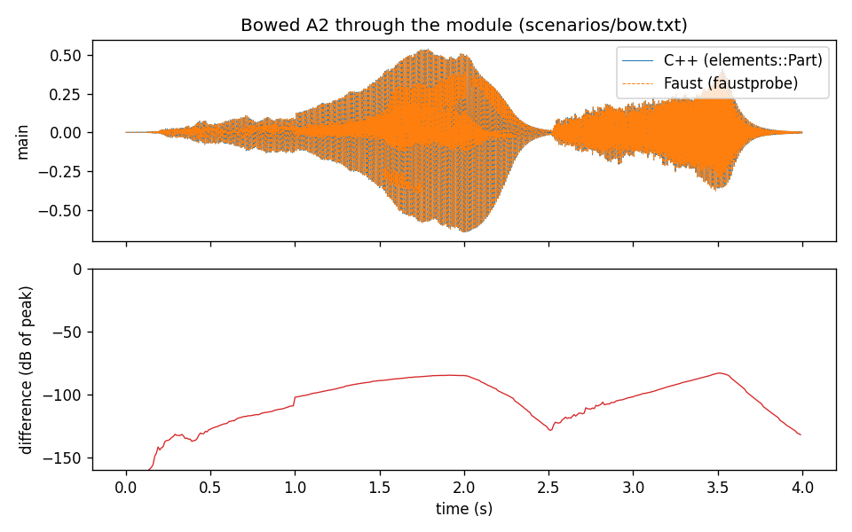

# faust-elements

**Mutable Instruments Elements, la voix de synthèse modale d'Émilie Gillet, écrite en Faust pour [faust-rs](https://github.com/grame-cncm/faust-rs), et vérifiée échantillon par échantillon contre le C++ du module lui-même.**

*English version: [README.md](README.md). L'article (en anglais) : [paper/faust-elements.pdf](paper/faust-elements.pdf).*

[Elements](https://pichenettes.github.io/mutable-instruments-documentation/modules/elements/) est un module Eurorack de 2014 dont le micrologiciel est libre (MIT, [pichenettes/eurorack](https://github.com/pichenettes/eurorack), `elements/dsp`). C'est une voix complète de modélisation physique, environ 3 700 lignes de C++ qui tournent à 32 kHz sur un Cortex-M4 :

- trois **excitateurs** : un *archet* (un bruit qui change de signe au hasard, filtré passe-bas), un *souffle* (un lecteur granulaire d'un échantillon de bruit, un modèle d'anche et de tuyau au-delà des 2/3 du niveau, puis un diffuseur de quatre passe-tout) et une *frappe* dont la commande « meta » passe de neuf échantillons de maillets et de coups à une impulsion de maillet, un plectre (deux impulsions et un étouffement) et des particules qui rebondissent ;
- une **enveloppe** (contour : percussif, AD, ADSR, AR) et une entrée de force avec ses tables d'accent ;
- un **résonateur** : 52 modes passe-bande à retour sans délai, étirés par la géométrie (d'une barre à une cloche et au-delà), leur Q réglé par l'amortissement et la brillance, captés en deux points par un peigne en cosinus appliqué aux amplitudes, plus 8 modes frottés, chacun une ligne à retard bouclée sur un passe-bande et une table de frottement d'archet ; ou, dans ses modes cachés, **une corde** ou un **accord de cinq cordes** (Karplus-Strong à lecture d'Hermite, amortissement par un FIR et un SVF, dispersion par un passe-tout, du bruit et un chevalet courbe, un micro en peigne) ;
- la section **espace** : élargissement stéréo, puis une réverbération de Griesinger (la topologie de Dattorro) dont la mémoire est sur 16 bits, figée en fin de course du bouton.

Ce dépôt réécrit le tout en une bibliothèque Faust, [dsp/elements.lib](dsp/elements.lib) (préfixe `el`, 24 fonctions documentées), et pose la question : un programme Faust peut-il donner *les mêmes échantillons* que le micrologiciel, et pas seulement le même genre de son ? La réponse, mesurée sur 11 scénarios qui exercent chaque modèle d'excitateur, les trois résonateurs, les paramètres qui bougent sous une note tenue, l'entrée externe et la réverbération ([results/compare.txt](results/compare.txt)) :

- en simple précision, le modèle Faust suit `elements::Part` (le module entier) à **-72 dB du pic ou mieux sur chaque scénario, -100 dB sur la plupart**, et `elements::Voice` à -82 dB ou mieux, échantillon par échantillon sur 2 à 6 secondes ;
- en double précision l'accord va de -28 à -123 dB : le C++ accumule quelques phases en float32 (le LFO du micro latéral, les rampes de la corde, les deux LFO de la réverbération), le modèle en double précision accumule les mêmes incréments plus exactement, et les deux s'écartent. Le modèle en simple précision, qui fait les mêmes opérations en float, ne s'écarte pas ([results/fig_precision.png](results/fig_precision.png)) ;
- la sortie ne dépend ni de la taille de bloc de l'hôte (1, 7, 16 ou 512 trames), ni d'une réinitialisation, ni de la compilation (`faustprobe --check all`) ;
- le module coûte 10,7 ms de calcul par seconde d'audio en mode modal, en natif (faust-rs vers C++, clang -O3), 3,2 fois le C++ d'origine ; 2,8 et 4,9 ms pour une corde et pour les accords, 1,9 et 1,25 fois ([results/cost.txt](results/cost.txt)).



## 1. Comment un moteur par blocs devient un flux d'échantillons

Le C++ traite des blocs de 16 échantillons. La lecture des commandes, les fronts de la porte, l'enveloppe, l'excitateur de frappe, les coefficients des 52 modes et les paramètres des cordes sont calculés une fois par bloc ; les boucles par échantillon font ensuite varier quelques valeurs en rampe sur le bloc. Obtenir les mêmes échantillons dans un langage échantillon par échantillon a demandé cinq choses.

**L'horloge des blocs.** `el.blk` vaut 1 sur le premier échantillon de chaque bloc, compté depuis le premier échantillon que calcule le programme, comme le premier bloc du C++. Tout ce que le C++ calcule une fois par bloc est un domaine `ondemand` de faust-rs cadencé par `blk` : ses entrées sont lues à cet échantillon, ses sorties sont tenues pendant le bloc, et son propre état (`~`, retards) avance d'un pas par bloc. L'enveloppe (`el.envelope_block`), les fronts de la porte, les modes (`el.modes_block`, y compris le rafraîchissement des 27 modes supérieurs un bloc sur deux, comme dans le C++), le choix de l'accord avec son hystérésis, les paramètres des cordes : ce sont autant de domaines de ce genre. Les commandes elles-mêmes sont tenues par bloc (`_hb`) : une commande bougée au milieu d'un bloc prend effet au suivant, comme sur le module.

**Des rampes qui s'accumulent comme celles du C++.** Le C++ fait varier l'enveloppe, la force, la position du micro et quatre paramètres de corde en ajoutant à une valeur courante un incrément calculé en début de bloc, `(cible - valeur) / 16`. `_ramp` fait exactement cela, à partir de la valeur atteinte à la fin du bloc précédent, si bien que les arrondis de la somme sont aussi ceux du C++.

**Un seul générateur aléatoire, partagé, dans l'ordre du C++.** `stmlib::Random` est un unique générateur congruentiel linéaire dans lequel l'archet tire 16 fois par bloc, puis le souffle 16 fois, puis les particules de la frappe de 0 à 4 fois selon leurs rebonds (un mot au front montant, deux ou trois par rebond, au plus un rebond par bloc), puis chaque corde une fois par pas. Le modèle garde l'état du générateur au début du bloc et donne à chaque consommateur le mot même qu'il tirerait, par le saut de k pas du générateur (`lcg_a(k) s + lcg_c(k)`, tabulé à partir du pas du C++ lui-même) : l'archet reçoit les mots 1 à 16, le souffle 17 à 32, la frappe déroule ses 16 pas au rythme des blocs à partir du mot 33 (`el.random_block`), et chaque corde commence après les mots des cordes qui la précèdent. Une corde sous 15,7 Hz avance moins d'une fois par échantillon ; ses pas sont comptés en début de bloc en déroulant sa phase sur le bloc, pour que les mots de la corde suivante restent justes. Les entiers sont sur 32 bits et bouclent comme en C : les comparaisons non signées inversent le bit de signe, les décalages non signés masquent.

**Ce que le C++ ne traite pas reste immobile.** En mode corde, le résonateur modal n'est pas appelé ; un mode frotté au-delà du nombre de modes actifs, les quatre cordes de plus en mode une corde, le passe-tout de dispersion quand il est hors de la boucle, et une corde lente entre ses pas ne sont pas traités. Chacun est un domaine `ondemand` dont l'horloge est cette condition : ses filtres et ses lignes à retard se figent et repartent là où ils en étaient, comme ceux du C++. Les modes au-delà du nombre de modes actifs gardent leur état par une sélection.

**Des lignes à retard lues comme des tampons circulaires.** Une `DelayLine` du C++ lue au décalage k avant son écriture rend ce qui a été écrit k écritures plus tôt, et 2048 écritures plus tôt quand k est un multiple de la taille ; après l'écriture, le décalage k rend ce qui a été écrit k - 1 écritures plus tôt, la valeur courante pour 1. `_ring` et `_ring_post` donnent ces lectures sur la valeur rebouclée d'une récursion. Le moteur de la réverbération (`FxEngine`) partage un tampon de 16 bits entre dix lignes ; son premier passe-tout est « étalé » en lisant sa ligne à un décalage modulé par un LFO et en réécrivant le résultat 100 cases plus loin, où la queue le relit 49 échantillons plus tard. Le modèle l'écrit `_q16(interpolation) @ 49`, et quantifie chaque écriture sur 16 bits comme le fait `Compress`.

Les tables (courbes d'enveloppe, accent, raideur, coefficients des SVF, MIDI vers fréquence, les 128 013 échantillons de la frappe et les 40 963 du bruit du souffle) sont relues dans le C++ compilé par `build/dump tables`, pas recalculées, et écrites dans [dsp/elements_tables.lib](dsp/elements_tables.lib). De même pour quatre constantes que le C++ calcule en float32 : les probabilités des particules, le retard initial des cordes et les coefficients des LFO de la réverbération. Ces derniers comptent : le LFO est une récursion résonante de coefficient 1,99999702, si proche de 2 qu'une unité sur le dernier chiffre change sa fréquence de 2 % ; avec le coefficient calculé en double, les décalages de lecture de la réverbération dérivaient et le scénario d'espace s'accordait à -26 dB en simple précision ; avec la valeur float32, à -74 dB.

## 2. Résultats

`make results` rend chaque scénario de [scenarios/](scenarios) par `build/dump` (`elements::Voice` et `elements::Part` du micrologiciel, compilés avec `-ffp-contract=off`) et par faustprobe (`dsp/elements_voice.dsp`, `dsp/elements.dsp`, `--sr 32000 --block 16`, les changements de commandes du scénario en `--set` et `--at`), en simple et en double précision : 44 rendus, comparés sur toute leur durée. Le pire canal de chacun, en dB de son pic :

| scénario | ce qu'il exerce | module, simple | voix, simple | module, double | voix, double |
|---|---|---|---|---|---|
| strike | le patch par défaut, un maillet | -103 | -90 | -123 | -111 |
| samples | le lecteur d'échantillons de la frappe, trois échantillons et timbres | -98 | -82 | -52 | -35 |
| plectrum | plectre et étouffement | -116 | -97 | -67 | -52 |
| particles | rebonds aléatoires, trois portes | -105 | -97 | -38 | -28 |
| bow | archet, ADSR, position et timbre qui bougent | -83 | -84 | -58 | -35 |
| blow | bruit granulaire, puis l'anche | -105 | -95 | -56 | -46 |
| string | une corde, dispersion, amortissement infini | -101 | -101 | -58 | -60 |
| chords | cinq cordes, accords, une corde sous 15,7 Hz, accord frotté | -102 | -103 | -88 | -92 |
| moves | paramètres en mouvement, modèle changé sous une note tenue | -84 | -85 | -54 | -42 |
| space | direct, stéréo, réverbération, réverbération figée | -72 | -97 | -50 | -39 |
| input | un signal externe dans le résonateur | -105 | -86 | -95 | -76 |

Sur la machine de [results/compare.txt](results/compare.txt) : Apple M5, Apple clang 21.0.0, Elements à eurorack `f4cfa76` (stmlib `e3bd7c9`), faust-rs `172305ea` (faustprobe 0.9.2).

- **La simple précision** est la comparaison qui compte : le modèle fait les opérations en float du C++, il doit donc donner les résultats en float du C++, et les donne, aux réordonnancements près des sommes et des produits que le compilateur Faust est libre de faire (un ulp ici et là). Quand un ulp franchit un seuil, l'écart peut grandir : la réverbération sur 16 bits arrondit une valeur d'un côté plutôt que de l'autre, et la différence circule dans ses boucles (le scénario d'espace, -72 dB du pic, -77 dBFS : quelques unités de la mémoire 16 bits), et les modes frottés, une boucle non linéaire, amplifient les écarts (le scénario d'archet, -83 dB).
- **La double précision** montre où dérive le float32 du C++. Dans chaque scénario l'excitation brute s'accorde à -99 dB ou mieux ; la sortie latérale, qui porte le LFO du micro accumulé en float32 par le C++, diverge au bout de quelques secondes ; les cordes, dont les rampes de retard s'accumulent en float32, aussi. [results/fig_precision.png](results/fig_precision.png) montre la sortie latérale du scénario des particules : sous -97 dB de son pic en simple précision tout du long, -30 dB au bout de trois secondes en double.
- La vérification a été mise en échec une fois : le gain d'entrée du résonateur passé de 0,125 à 0,126 donne -42 dB sur la sortie centrale et le code de sortie 1.

**Coût** ([results/cost.txt](results/cost.txt), `make cost`, 100 s d'une note frottée, calcul seul) :

| résonateur | C++ (`build/dump`, -O2) | Faust natif (faust-rs, clang -O3) | faustprobe (JIT Cranelift) |
|---|---|---|---|
| modal | 3,4 ms/s | 10,7 ms/s | 17,1 ms/s |
| une corde | 1,5 ms/s | 2,8 ms/s | 6,7 ms/s |
| cinq cordes | 3,9 ms/s | 4,9 ms/s | 13,7 ms/s |

La différence est dans les modes : avec 26 modes au lieu de 52, le module natif coûte 6,4 ms/s au lieu de 10,4, donc les 52 modes font environ 8 ms de ses 10,7, quand le module C++ entier coûte 3,4. Le code généré garde l'état de chaque mode dans la structure du DSP et le décale à chaque échantillon, là où le C++ parcourt un tableau de filtres ; que ce soit toute la cause n'a pas été mesuré. À 10,7 ms par seconde, le module occupe environ 1 % d'un cœur.

## 3. Organisation

| chemin | contenu |
|---|---|
| `dsp/elements.lib` | le modèle (préfixe `el`), documenté au format des faustlibraries : chaque fonction publique a son `#### Usage` et son `#### Test` (`make doctests`) |
| `dsp/elements_tables.lib` | généré : les tables, échantillons et constantes float32 du C++ (`make tables`) |
| `dsp/elements.dsp` | le module : deux entrées audio (souffle, frappe), deux sorties (main, aux), les commandes du panneau |
| `dsp/elements_voice.dsp` | la voix seule (raw, center, side), comparée à `elements::Voice` |
| `dsp/elements_poly.dsp` | un instrument MIDI polyphonique : la voix par note (freq, gain comme force, gate), `effect = el.body` (mixage, limiteur, réverbération) |
| `ref/dump.cpp` | lie les sources d'Elements sans les modifier ; extrait les tables, rend des scénarios par `Part`, `Voice` ou la réverbération seule |
| `scenarios/` | les scénarios de test (`TRAME NOM VALEUR`, aux frontières de blocs) et `demo.txt`, un parcours à écouter |
| `scripts/` | `compare.py` (un scénario, les deux modèles), `results.py`, `cost.sh`, `figures.py`, `gen_tables.py`, `check_doc_tests.py` |
| `tools/render.cpp` | le rendu natif d'un scénario par le C++ de faust-rs (`make render`) |
| `tests/` | les lectures de table d'`elements.lib` avec des arguments hors plage (`make check`) : `signature_out_of_range.dsp` contre `signature_bounds.dsp` (l'échantillon de bruit du souffle), `table_reads_out_of_range.dsp` contre `table_reads_bounds.dsp` (`s2r`, les filtres des timbres, le lecteur d'échantillons de la frappe, l'accent) |
| `web/` | la version web : page, clavier, MIDI, hôte AudioWorklet du wasm de faust-rs, explorateur en orbite, atlas des sons, orbite des timbres (`make web`, `make web-serve`, `make web-check`, `make web-presets`, `make web-atlas`) ; `web/vendor/faust-orbit-ui` est faust-orbit-ui 0.4.1 |
| `web/phone/`, `web/pwa.js` | l'application pour téléphone (PWA) que la page fabrique dans son onglet Téléphone : la page de l'application, son clavier et le mouvement (`phone/`), l'onglet (`pwa.js`), les associations de l'accéléromètre (`motion.js`), les QR codes (`qrcode.js`), faust-ui en option (`vendor/faust-ui`, GPL-3.0-or-later) ; servie par `scripts/web_serve.py`, certificats par `scripts/pwa_cert.sh` (`make pwa-cert`) |
| `paper/` | l'article, `faust-elements.pdf` (`make paper`) |
| `faust-rs-issues/` | ce que le portage a trouvé dans faust-rs |

## 4. Utilisation

```bash
make ref        # build/dump, contre ../../mi-eurorack (ELEMENTS=...)
make tables     # dsp/elements_tables.lib à partir du C++
make check      # chaque programme compile ; --check all sur le module
make doctests   # les 24 blocs #### Test d'elements.lib
make test       # chaque scénario, voix et module, simple et double précision
make results    # results/compare.txt et results/cost.txt
make paper      # paper/faust-elements.pdf
make render     # build/demo.wav, le rendu natif de scenarios/demo.txt (32 kHz)
make web        # web/dsp : la voix et le corps en wasm ; make web-serve, puis http://localhost:8000/web/
```

`ELEMENTS` désigne une copie de [pichenettes/eurorack](https://github.com/pichenettes/eurorack) avec son sous-module `stmlib` (`git submodule update --init stmlib`), `FAUST_RS` une copie de faust-rs où `faust-rs` et `faustprobe` sont construits en release. Python 3 avec numpy (et matplotlib pour `scripts/figures.py`), node pour `make web-check`.

**La fréquence d'échantillonnage est 32 kHz.** Chaque table, longueur de retard et coefficient du C++ est calculé pour la fréquence du codec du module, et le modèle les garde : faites-le tourner à 32 kHz (`faustprobe --sr 32000` ; un contexte Web Audio peut être créé à 32 kHz, le navigateur rééchantillonne). À une autre fréquence il joue, transposé, toutes ses constantes de temps mises à l'échelle.

**Commandes** (les noms sont ceux des champs `Patch` et `PerformanceState` du C++ ; les plages, celles que leur donne `CvScaler`) :

| groupe | commandes |
|---|---|
| exciter | `envelope` (contour), `bow`, `blow`, `strike` (niveaux), `bow_timbre`, `flow` (meta du souffle), `blow_timbre`, `mallet` (meta de la frappe), `strike_timbre` |
| resonator | `geometry`, `brightness`, `damping`, `position`, `model` (0 modal, 1 corde, 2 cordes) |
| space | `space` (direct sous 0,1, stéréo, réverbération à partir de 0,6, figée au-delà de 1,75) |
| unit | `signature`, `mod_frequency`, `mod_offset` (0 à 0,5), `diffusion`, `reverb_lp` : ce que `Part::Seed` tire du numéro de série de chaque module, aux valeurs de `Part::Init` |
| performance | `note` (MIDI), `strength` (l'entrée de pression, 0,5 vaut l'unité), `modulation` (demi-tons, l'entrée FM), `gate` |

## 5. Version web

`web/` joue l'instrument dans le navigateur. `make web` compile la voix et le corps de `dsp/elements_poly.dsp` en WebAssembly avec faust-rs (simple précision), `make web-serve` sert le dépôt ; ouvrir ensuite http://localhost:8000/web/ (Web MIDI et l'AudioWorklet demandent localhost ou HTTPS).

- **Moteur.** Un AudioWorklet (`web/elements-processor.js`) à 32 kHz, la fréquence du modèle, que le navigateur rééchantillonne vers la carte son. Il fait tourner de 1 à 16 voix, 8 par défaut (1, c'est le module lui-même, qui est monophonique), somme leurs raw, center et side dans le corps comme `Part` somme ses voix, envoie chaque commande à chaque voix et au corps, commence chaque note par un bloc de 16 trames porte basse pour que la voix voie toujours un front montant (une touche rejouée refrappe sa propre voix sur les cordes qui sonnent encore), retient un relâchement arrivé avant que la frappe ait été calculée, cesse de calculer une voix restée silencieuse une seconde (trois si sa touche est encore tenue), et prend la plus ancienne voix relâchée, sinon la plus ancienne tenue. Une voix dont la sortie n'est pas finie ou dépasse 1000 voit son état remis à zéro (`instanceClear`) : Elements diverge vraiment, une corde sans perte (amortissement au-delà de 0,95) sous un archet fort et à une hauteur élevée croissant sans limite dans le C++ comme dans le modèle, et le module réinitialise alors sa voix (le « panic » de `Part::Process`, non porté dans la bibliothèque).
- **Jeu.** Le clavier de la page, de C1 à C8 dans une zone qui défile (plus bas sur une touche, plus fort ; en glissant on passe d'une touche à l'autre, un glissando, une note par doigt sur un écran tactile, comme dans faust-coopiano), le clavier d'ordinateur (deux rangées depuis Z et Q, signalées sur la page, ← → pour l'octave), Web MIDI (notes et vélocité, pitch bend sur l'entrée de modulation sur ±2 demi-tons, arrêt de toutes les notes). Un maintien fonctionne comme la pédale forte d'un piano, pour les accords : tant qu'il est actif, les touches relâchées continuent de sonner (affichées d'une couleur plus claire), et le relâcher les arrête. Il est actif tant que l'interrupteur *Maintien* est enclenché, que la barre d'espace est enfoncée ou qu'une pédale MIDI (CC64) est baissée.
- **Commandes.** Toutes les commandes de la voix et du corps, un onglet par groupe du panneau (excitateur, résonateur, espace, unité, jeu ; le navigateur retient le dernier), chacune expliquée en anglais et en français, et 24 préréglages : les réglages du module ; frappés (lame de bois, cloche, gong, steel drum, bloc de bois, kalimba), frottés et soufflés (verre frotté, bol chantant, archet grave, tuyau à anche, souffle, flûte, clarinette), cordes (corde pincée, harpe, corde dispersive, corde étouffée, accord de cordes, accord frotté) et textures (particules, bâton de pluie, carillon à vent, drone). `make web-presets` rend chacun avec le wasm sur trois touches et échoue si l'un est presque muet ou dépasse 0 dBFS ; les sons eux-mêmes restent à juger à l'oreille.
- **Orbite.** Un onglet explore l'espace des paramètres avec [faust-orbit-ui](https://github.com/orlarey/faust-orbit-ui) (Yann Orlarey, MIT ; la 0.4.1 est copiée dans `web/vendor/faust-orbit-ui`) : chaque commande de la voix et du corps (sauf la note, sa vélocité et le décalage de hauteur) est un point sur une orbite, que l'on déplace un à un ou tous ensemble depuis le centre, ou que l'on disperse au hasard. Sa bibliothèque part des 24 préréglages, projetés sur un plan (ACP) : un clic sur un disque rappelle un préréglage, glisser la croix entre les disques passe d'un son à l'autre (interpolation de Shepard), un double-clic garde le son courant. L'orbite et les autres onglets se suivent dans les deux sens, et le menu des préréglages affiche celui que l'orbite a rappelé, ou marque le dernier comme modifié ; le modèle, un nombre entier, est arrondi pendant que l'orbite interpole. Ce qui est ajouté, renommé ou supprimé dans la bibliothèque est gardé par le navigateur.
- **Atlas.** Le dernier onglet place les sons selon ce qu'ils font entendre plutôt que selon leurs commandes. `make web-atlas` (`scripts/gen_atlas.mjs`, environ une minute) rend 2 000 patchs aléatoires, tirés comme le Random de l'orbite, et les 24 préréglages avec le wasm de la page, chacun en la 3 à la vélocité 0,7 tenu une seconde, et les mesure avec `web/describe.js`, où se trouvent les définitions : brillance (centroïde spectral), bruit (platitude spectrale, les raies à plus de 100 dB sous la plus forte comptées à ce niveau), harmonicité (part de l'énergie proche des harmoniques de 220 Hz), attaque, tenue, extinction à −30 dB (extrapolée depuis la pente des 500 dernières ms quand le rendu se termine avant, comme pour 65 % des sons, au plus 30 s), niveau et largeur stéréo. Le plan est formé des deux premières composantes principales des descripteurs centrés réduits, niveau excepté : l'enveloppe (tenue, extinction, attaque ; 28 % de la variance) et le spectre (brillance et bruit ; 25 %) ; n'importe quel descripteur peut être choisi comme axe à la place. La couleur d'un point est le modèle du résonateur, les préréglages sont nommés, le survol montre les mesures, et un clic charge le patch (l'orbite et le menu des préréglages suivent) et joue la note avec laquelle il a été mesuré. La molette ou un pincement zoome autour du pointeur (sur les graduations d'un axe, cet axe seul), un glissé déplace la vue, et un double-clic ou le bouton ⤢ montre de nouveau tout l'atlas ; la petite carte à côté de l'orbite zoome de même. Sur un écran large, un séparateur entre les deux côtés des onglets Orbite et Atlas partage la largeur : glissez-le (ou utilisez les flèches), double-cliquez-le pour le partage par défaut ; le navigateur retient le partage. Le résultat, `web/atlas.json` (environ 400 Ko, avec le centrage-réduction, pour que la page puisse placer de nouveaux sons), est généré et non commité ; `make web-serve` le construit. Les niveaux de huit sons rendus à nouveau par faustprobe depuis `dsp/elements_poly.dsp` concordent à 0,02 dB près ; les patchs sont rendus avec leurs valeurs arrondies à trois chiffres, telles qu'enregistrées, car certains bougent de plusieurs dB avec le quatrième.
- **Le son courant.** Après chaque changement (un curseur, un préréglage, l'orbite, l'atlas), un Web Worker (`web/measure-worker.js`) rend et mesure le patch courant comme l'atlas, en 28 ms environ, et un losange le place sur l'atlas et sur une petite carte à côté de l'orbite : on voit où un mouvement de l'orbite emmène le timbre.
- **Orbite des timbres.** À côté de l'atlas, un second faust-orbit-ui dont les points sont les huit descripteurs plutôt que les commandes, chacun un centile parmi les sons de l'atlas (0,5 : le son médian). Les déplacer demande un son : la page charge le son le plus proche de l'atlas (du modèle courant s'il en a un presque aussi proche, pour que le modèle ne clignote pas), puis, quand les points s'arrêtent, le worker l'affine par une recherche locale sur 40 rendus mesurés (environ une seconde). L'atlas montre le son demandé (un anneau pointillé), le son obtenu (le losange) et l'écart entre eux en centiles. Sa bibliothèque contient les préréglages à leurs centiles mesurés, si bien que son calque les place selon leur timbre. Mélanger les commandes de plusieurs voisins a été essayé puis abandonné : sur 30 cibles, le son le plus proche seul est à un écart médian de 11 centiles, un mélange de deux à six à 21–24, car les commandes d'Elements ne se combinent pas linéairement en timbre ; la recherche gagne ensuite environ deux points. Toutes les combinaisons de descripteurs n'existent pas : une demande au hasard obtient le son atteignable le plus proche, typiquement à 10–20 centiles.
- **Application pour téléphone.** L'onglet Téléphone fabrique une application pour le téléphone (une PWA) à partir du son courant : la page réunit les DSP wasm, son lecteur AudioWorklet, une page pour le téléphone (`web/phone/` : un clavier de deux octaves avec glissando, un maintien, les jauges du mouvement) et un `config.json` avec le patch et les associations, ajoute un manifeste, des icônes dessinées sur un canvas et un service worker qui met tous les fichiers en cache (l'application joue alors hors ligne), et les envoie au serveur de la page (`POST /pwa/apps`, rangés dans `build/pwa/ID/`). Une association lie une commande à un axe de l'accéléromètre (X, Y ou Z, en m/s² avec la gravité : incliner le téléphone) avec la sémantique des métadonnées `[acc: axe courbe amin amid amax]` de Faust (`FaustSensors.ts` de faustwasm, `ValueConverter.h` des architectures), réécrite dans `web/motion.js` : l'axe borné à bas .. haut et appliqué par deux segments sur le min, le centre et le max de la commande selon une courbe (Monte, Descend, Monte-descend, Descend-monte), lissé par un passe-bas de 80 ms, les axes d'Android ramenés à ceux d'iOS. Trois curseurs simulent les axes sur l'ordinateur. Des options choisissent ce que montre le téléphone : le clavier, un bouton ON/OFF qui tient une note choisie (comme l'interrupteur ON/OFF des applications SmartFaust, le téléphone devenant un instrument joué par son mouvement), et l'interface faust-ui de toutes les commandes (`web/vendor/faust-ui`, faust-ui 1.1.19 de Fr0stbyteR, GPL-3.0-or-later : une application fabriquée avec elle la contient et est distribuée sous GPL), dont les widgets suivent le mouvement. L'application est ensuite montrée en QR code (`web/qrcode.js`, écrit pour la page, décodé par le lecteur du système dans `make check-qrcode`), servie en lecture seule, jamais le reste du dépôt, soit sur le réseau local en HTTPS (`make pwa-cert` crée une autorité locale, limitée par des contraintes de noms aux adresses privées et aux noms `.local`, à laquelle le téléphone fait confiance une fois depuis un second QR code, et un certificat pour l'adresse de cette machine ; `https://IP-LOCALE:8443/ID/`), soit par un tunnel ngrok sur une adresse HTTPS publique (lancé par la page, vers un port qui ne sert que les applications). Vérifié : la page fabrique et range une application (16 fichiers, 1,0 Mo), le serveur HTTPS répond avec le certificat local (`curl --cacert`), les listes de répertoires, `..` et les autres origines sont refusés ; Chrome sans interface (un profil temporaire) trouve le service worker actif, les 16 fichiers en cache, aucune erreur d'installabilité, l'application qui marche hors ligne et les jauges qui suivent les axes ; avec les options, le bouton ON/OFF, le clavier masqué, les 21 widgets de faust-ui et son curseur de géométrie qui suit l'axe X. Non vérifié : un vrai téléphone (l'installation, la demande d'autorisation d'iOS, les capteurs), le mode ngrok (il publie les applications), la confiance d'Android dans une autorité installée par l'utilisateur. Le navigateur intégré de la page refuse les service workers.
- **Commandes hors plage.** Faust ne borne pas une commande par sa plage déclarée, et un hôte peut écrire au-delà (l'hôte wasm de la page écrit ce qu'on lui donne). `make web-bounds` (`scripts/check_bounds.mjs`) écrit chacune des 22 commandes de la voix et du corps, et la vélocité, bien en dessous et au-dessus de sa plage : avant la correction, 27 des 44 écritures différaient de leur borne, sept donnaient NaN (bow_timbre, strike_timbre, brightness, position, mod_frequency, mod_offset, reverb_lp) et, d'après leurs formules d'index et la taille des tables, cinq familles de lectures de table pouvaient sortir de leurs tables (l'échantillon de bruit du souffle par la signature, `s2r`, les tables de filtre des timbres, les bornes des échantillons de la frappe par un mallet négatif, l'accent par une vélocité au-dessus de 1). Chaque commande est maintenant bornée à sa plage là où elle est définie, la vélocité à l'entrée de la voix, et les index de table sont bornés à nouveau en entiers dans les fonctions, pour les appels directs ; les 44 écritures sonnent exactement comme leur borne. Dans les plages rien ne change : `make test` affiche les mêmes lignes, et l'atlas (2 024 patchs dans le wasm en simple précision) est le même fichier, octet pour octet. Une première version bornait aussi l'argument flottant de `s2r`, et le compilateur groupait alors `st + 128` autrement : les accords en simple précision bougeaient d'un ulp, que les cordes amplifient (l'atlas changeait 391 de ses 16 192 valeurs) ; `s2r` ne borne que ses index entiers.
- **Patchs aléatoires.** `make web-fuzz` joue 2 000 patchs aléatoires dans le wasm, comme le Random de l'orbite, avec la garde de la page, et échoue si une valeur non finie ou énorme atteint la sortie. Il a montré qu'un `mod_offset` au-delà de 0,85 fait diverger l'oscillateur cosinus du micro latéral (ses amplitudes atteignent 1e35) : le numéro de série du module lui donne 0,05 à 0,15, et le curseur s'arrête désormais à 0,5. Les rares voix que la garde remet à zéro divergent aussi dans le C++.
- **Vérification.** `make web-check` rend le wasm sous node comme le fait le worklet et le compare à faustprobe (`--nvoices 1`, simple précision) sur trois notes : une note frappée à -132 dB du pic, une note frottée identique, un accord de cordes à -78 dB ; le wasm coûte de 13,6 à 16,9 ms par seconde d'audio pour une voix et le corps (node 22, Apple M5).

## 6. Ce qui n'est pas porté

- La **voix Ominous**, l'« easter egg » du module (un autre moteur de synthèse).
- Le **panic** et le **bypass** de `Part` : quand le niveau du résonateur dépasse 200, le C++ réinitialise la voix pendant un bloc ; aucun scénario n'y arrive.
- **Le matériel autour de `Part`** : le lissage et l'étalonnage des potentiomètres par le `CvScaler`, les portes de bruit des entrées dans `elements.cc`, le `SoftConvert` 16 bits du codec.
- Une meta de frappe valant exactement 1, où l'indice de modèle du C++ atteint FLOW : `CvScaler` plafonne le bouton à 0,9995, le curseur aussi.
- Dans `elements_poly.dsp`, chaque voix a son propre générateur, là où `Part` à plusieurs voix en partagerait un.

## 7. faust-rs

Le portage a trouvé un défaut, conservé avec son cas réduit dans [faust-rs-issues/unbounded-delay](faust-rs-issues/unbounded-delay) : un retard lu à un décalage dont le compilateur ne peut borner l'intervalle (ici, un LFO calculé par une récursion, passé par `int()`) est accepté par faust-rs, qui dimensionne la ligne à 2^31 échantillons. Le compilateur C++ refuse le même programme en donnant l'intervalle dans son message. La classe générée fait alors 8 Gio, et un hôte qui l'alloue sur la pile plante, tandis que faustprobe rend le programme normalement. Le modèle borne désormais ces décalages à la plage que lit le C++. faust-rs a été corrigé depuis (`main-dev` `10b26062`) : il refuse une borne haute d'INT_MAX ou plus et un intervalle couvrant toute la plage des entiers, avec le diagnostic `delay-interval`.

Tout le reste de ce dont le portage avait besoin était là : `ondemand` imbriqué sur trois niveaux (le passe-tout de dispersion dans le pas de la corde dans la corde), à l'intérieur de récursions ; l'arithmétique entière 32 bits qui boucle ; des tables `waveform` de 128 013 échantillons (la voix compile en 1,2 s).

## Licence

MIT, comme le micrologiciel d'Elements. Le modèle : GRAME, 2026. Le code DSP d'Elements, et les tables et échantillons de `dsp/elements_tables.lib` : Émilie Gillet, 2014, MIT ([LICENSE](LICENSE)).
